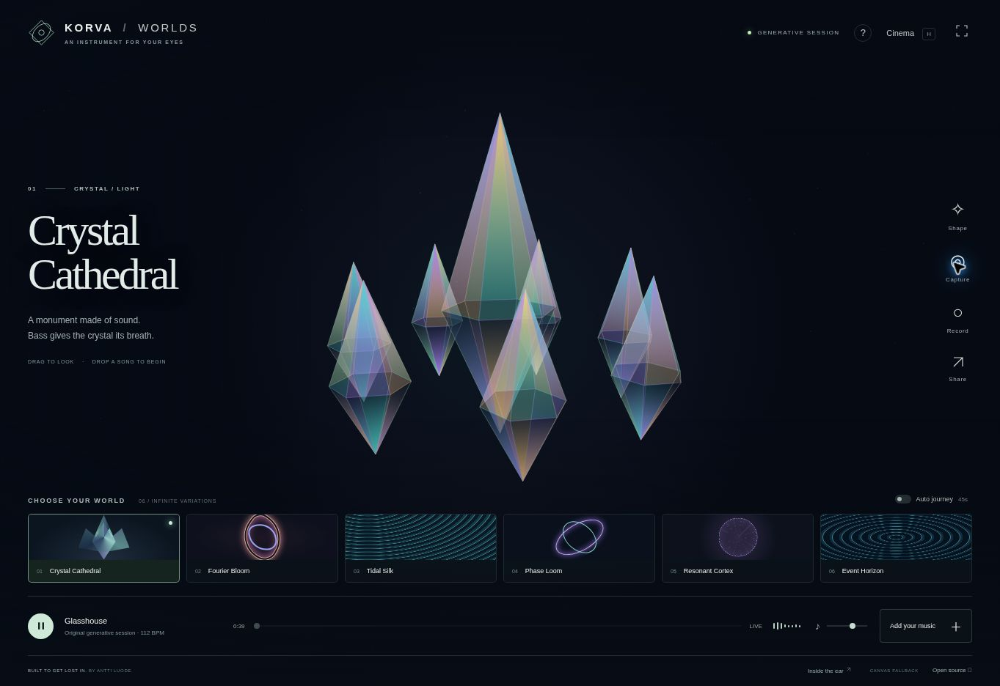

# KORVA / WORLDS

### See what you hear.

**[Enter the visualizer →](https://anttiluode.github.io/MusicVisualizer1/)**

Six listening worlds. Drop a song, start the original generative session, or connect a live input. Crystals breathe, harmonics bloom, silk flows, and the waveform becomes a sculpture.

A substantial upgrade to MusicVisualizer1, inspired by Antti Luode’s experiments with phase, resonance, memory and light. The original **52-ring Korva organ and trained tiny transformer are still here**, running locally alongside the visual engine.

**Free · MIT · No account · No uploads · No CDN · No build step**



*Actual browser capture of the lightweight fallback. WebGL adds lit surfaces and procedural depth.*

## Enter a world

| World | What you see | What the sound changes |
|---|---|---|
| **Crystal Cathedral** | A floating cluster of faceted crystals above a luminous floor | Bass and middle bands change crystal dimensions; slow prediction error shifts the color field |
| **Fourier Bloom** | Three interwoven, seven-fold harmonic ribbons | Bass changes thickness, middle bands fold the petals, treble adds surface light |
| **Tidal Silk** | Layers of luminous interference | Frequency energy deforms the currents and changes their brightness |
| **Phase Loom** | A rotating 3D delay embedding of the waveform | Actual samples provide x, y and z; spectral centroid changes the delay |
| **Resonant Cortex** | A spherical constellation with traveling connections | Eight bands light different nodes and connections; this is an artistic network, not RCNet inference |
| **Event Horizon** | Repeating twisted portals | Bass and middle bands change the portal radius and thickness |

**Five palettes:** Opal, Ember, Glacier, Orchid and Gold. Combine them freely, or try the four curated looks in **Shape**. Add Korva’s three selected memory rings to any world.

**Auto journey** moves through the worlds every 45 seconds while playing, with a soft dip in brightness. It is a timed visual journey, not a claim to recognize choruses or musical sections.

## Run it

Open **`index.html` directly** in a current Chrome, Edge or Firefox browser, or use the live Pages link. Keep the neighboring JS/CSS files with it. No server is needed for the demo or local audio files; the original model weights are included.

- **Enter with sound:** starts *Glasshouse*, an original synthesized 112-BPM electronic session with chords, arpeggios, bass and percussion. Sound begins only after an explicit action.
- **Add your music:** opens a local file. Playback and analysis stream immediately; there is no whole-song FFT wait or upload. Codec support depends on the browser.
- **Microphone:** live audio/instrument/loopback input. It is analyzed and available to recording but **never monitored through speakers**. Stop releases the tracks.
- **Browser tab:** desktop browsers supporting `getDisplayMedia` with audio, usually Chrome/Edge. Select a tab and enable **Share tab audio**. A screen/window may provide no audio. Video is not displayed or recorded by the visualizer.

Live capture requires a secure context (HTTPS or localhost) and permission. Other devices/browsers may not offer tab audio.

## Controls

| Control | Action |
|---|---|
| Space | Play/pause; stop live capture |
| 1–6, left/right arrows | Choose a world |
| Drag on the world | Look around (not all worlds use both axes) |
| H | Cinema: hide/show controls |
| F | Fullscreen where supported |
| S / Capture | Save a PNG of the artwork |
| Shape | Palette, response, drift, detail, gentle response, listening rings and presets |
| Record | Record artwork + audio to WebM; click again to finish; 60-second/100-MB limit |
| Share | Open a selectable URL and copy it; includes gentle response and rings |
| Inside the ear | View selected laps, surprise bars, prediction error and organ attention |

Record includes the analyzed input, at its analysis level; the playback volume slider controls your speakers, not export volume. The interface is excluded from PNG/video exports. Mic and tab capture are not monitored to avoid feedback or doubled audio. WebM recording requires `MediaRecorder` and canvas capture support. Audio rights are yours to check before sharing a clip.

Shared links never contain the audio file or microphone data. The recipient starts with the demo. Visual settings are also remembered locally when storage is available; disabling storage does not break startup. Drag/look position and current playback position are not saved.

## What actually runs

The main path uses **WebGL 1**, bounded procedural ray marching, and a Canvas compositor for signal traces and constellations. No neural image generation or heavy 3D engine is required. Render resolution adapts to observed frame time, with an internal WebGL budget of at most **1.2 million pixels**. Detail controls the resolution multiplier and ray step budget (at most 96 steps).

If WebGL is unavailable or its context is lost, distinct **Canvas alternatives** remain available for all six worlds. They preserve the interaction and audio pipeline, but are simpler interpretations of the WebGL artwork. Lower Detail or enable Gentle response on less capable devices. There is **no universal 60-FPS promise**.

The silent first view is explicitly labeled **Visual preview** and uses synthetic values. After audio starts, the scene receives measured audio features. Paused audio provides zero energy; the selected drift can continue. Set Drift to zero to hold the camera/world motion. Gentle response reduces audio response and drift; reduced-motion preferences are honored on first visit. This is not a guarantee against all visually intense motion.

## Inside the ear

`korva-engine.js` and `weights.js` are unchanged from the original Dream Garden version. The organ has 52 periods (13–64 ticks); the three lowest-surprise rings supply tokens to a two-layer, two-head, 48-wide trained transformer. A tick is 125 ms.

The new frontend reads live 2048-point Web Audio FFT data, summarizes eight frequency bands, and accumulates thresholded positive spectral changes between ticks. Continuous band energy drives the world; binary onsets drive Korva. Phase Loom uses the actual time-domain samples, plotted as `(x[n], x[n+d], x[n+2d])`, with bounded display gain. It is a delay-coordinate visualization, not proof of a reconstructed attractor.

**Limits:**

- Korva was trained on synthetic rhythms. Real music and this live frontend are out of distribution. Its prediction error is descriptive, not calibrated confidence, beat accuracy or song understanding.
- Quiet inputs can make multiple rings agree. Selected laps are not a reliable tempo estimate.
- Source changes, seeks and skipped audio-clock buckets **reset the predictor**. Background throttling can cause such a reset; we do not fabricate missed observations or compress a long gap into adjacent ticks.
- Rendering and feature sampling share the foreground animation loop. Background audio may continue; live visual/predictor updates are not promised while hidden.
- The procedural worlds are original artistic approximations. They do not run Moon’s trained/written light-transport network, CrystalMoon’s voxel simulation, or ResonantCortex’s neural model.

## Verification

```sh
node --test tests/*.test.cjs
node tests/smoke.cjs
```

The regression suite covers silence/transients, delayed samples, settings validation and sharing, render-size bounds, skipped clocks, keyboard dispatch, capture cancellation/cleanup, and restoring audible demo playback after live capture. The smoke test parses all scripts, checks DOM IDs, and verifies 160 ticks of the actual trained Korva engine, including the known 32/64-lap selection.

Optional Linux shader check (Mesa EGL and Pillow required):

```sh
python tests/shaders.py --output /tmp/korva-shaders
```

This compiles the actual GLSL and renders the four shader-based worlds with an offscreen EGL/GLES context. It is **not a browser compatibility or hardware speed benchmark**. See [verification notes](docs/VERIFICATION.md) for what was exercised and what remains device-dependent.

## Family tree & credit

| Ancestor | Contribution |
|---|---|
| [Korva](https://github.com/anttiluode/Korva) | Actual unchanged organ, inference engine and trained weights; MIT |
| [PhaseSpaceVisualizerVST](https://github.com/anttiluode/PhaseSpaceVisualizerVST) | The idea of making the audio signal itself visible |
| [ResonantCortex](https://github.com/anttiluode/ResonantCortex) | Phase/amplitude and constellation inspiration; no model imported |
| [Moon](https://github.com/anttiluode/Moon) & [CrystalMoon](https://github.com/anttiluode/CrystalMoon) | Crystal/light/world inspiration; no renderer or scientific claims imported |
| [FourierFlower](https://github.com/anttiluode/FourierFlower) | Harmonic flower inspiration |
| [GhostWorld](https://github.com/anttiluode/GhostWorld) & the Geometric Neuron / GoldOpus line | Prediction, visible history and rhythm-ring lineage |

All new rendering, audio and interface code is original to this repository. The CSS scene thumbnails are illustrative motifs, not screenshots. The demo music is synthesized locally from original patterns.

**[Original Dream Garden →](classic/index.html)** remains available. [Its original README](classic/README.md) documents that version’s different, precomputed audio pipeline.

13 November 2026 · Built with Antti Luode · MIT
